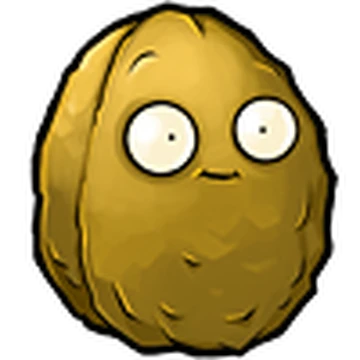

<div align="center">



# Орех

**Твёрдый ореховый друг, который живёт поверх всех окон и держит оборону, пока ты работаешь.**


</div>

---

## Что он умеет

- 🥜 **Живёт на рабочем столе.** Прозрачное окно без рамки и тени: на экране только сам орех, всегда поверх остальных окон и без значка на панели задач.
- 🫁 **Дышит и покачивается.** Даже в покое орех немного «дышит» и раскачивается, а при перетаскивании отстаёт от курсора и пружинит по инерции.
- 💬 **Болтает.** Сам время от времени выдаёт одну из 45 реплик: напоминает попить воды, размяться, сделать коммит, а иногда просто шутит. Реплики идут колодой, так что одна и та же фраза не повторится, пока не прозвучат остальные.
- 🎳 **Катается как в боулинге.** Его можно швырнуть мышкой: орех летит, крутится, отскакивает от краёв экрана, падает на панель задач и катится дальше, поднимая пыль. В конце он, как неваляшка, раскачивается и встаёт ровно.
- 👆 **Реагирует на клики.** Прыгает, приземляется со сплющиванием, разбрасывает крошки и отвечает одной из 20 реакций.
- 🖱️ **Не мешает.** Клики по прозрачной области вокруг ореха проходят насквозь в окна под ним, мышь ловится только над самим орехом.
- 🔋 **Почти не ест ресурсы.** Во время прыжков и перетаскивания рисует 60 кадров в секунду, а в покое ~25, этого хватает для плавного «дыхания».

## Управление

| Действие | Что произойдёт |
|---|---|
| **Клик** по ореху | прыжок, крошки и реакция |
| **Перетаскивание** | орех едет за курсором куда угодно, даже к самому верху экрана |
| **Бросок** (перетащить и отпустить на ходу) | орех улетает с той же скоростью и вращением |
| **Правый клик** | меню: «Поговорить», «Покатиться» и «Выход» |

При запуске орех сам встаёт в правый нижний угол, над панелью задач.

## Запуск

Нужен [Rust](https://rustup.rs) (stable, edition 2024).

```bash
git clone https://github.com/kexol/opex_pet.git
cd opex_pet
cargo run --release
```

Готовый файл лежит в `target/release/opex_pet.exe`. Картинка вшита внутрь, так что exe можно копировать куда угодно и запускать без остальных файлов. Чтобы орех появлялся при входе в Windows, положите ярлык на exe в папку автозагрузки (`Win+R` → `shell:startup`).

> В отладочной сборке (`cargo run`) рядом открывается консоль, в release её нет.

## Как это устроено

Весь питомец — один файл [`src/main.rs`](src/main.rs) на [eframe/egui](https://github.com/emilk/egui) с бэкендом `glow` (OpenGL).

- **Отрисовка.** Орех — текстурированный квад, который каждый кадр масштабируется и поворачивается вокруг точки опоры внизу. Из этого складываются дыхание, прыжки, сплющивание при приземлении и инерционное покачивание. Тень, крошки и пузырь с репликой рисуются примитивами egui.
- **Клики насквозь.** Каждый кадр приложение проверяет, где курсор: над эллипсом ореха или нет. Вне ореха окну включается `MousePassthrough`, и клики уходят в окна под ним.
- **Без системной тени.** egui-winit на Windows всегда просит тень для окон без рамки. Ради неё winit оставляет окну 1px системной рамки, и Windows рисует по ней тень. Приложение подменяет оконную процедуру и на `WM_NCCALCSIZE` отдаёт всё окно под клиентскую область. Через DWM дополнительно отключены скругление углов и цветная рамка Windows 11.
- **Своё перетаскивание.** Системное перетаскивание (`StartDrag`) не пускает верхний край окна выше экрана, а над орехом в окне есть место под пузырь. Поэтому окно двигается вручную, за курсором через `OuterPosition`.
- **Физика.** При броске или «боулинге» двигается само окно: гравитация, отскоки от стен, потолка и пола рабочей области того монитора, где сейчас орех, и качение без проскальзывания. Нижняя часть ореха «тяжелее», поэтому катится он с лёгкой раскачкой и в конце сам встаёт ровно. На скорости за ним тянется полупрозрачный след.
- **Адаптивная частота кадров.** 60 к/с, пока что-то быстро движется (прыжок, полёт, крошки, появление пузыря, перетаскивание), и ~25 к/с в покое.

## Своё имя и свои фразы

Всё настраивается константами в начале [`src/main.rs`](src/main.rs):

| Константа | Что это |
|---|---|
| `GREETING` | приветствие при запуске |
| `PHRASES` | реплики «сами по себе» и по пункту «Поговорить» |
| `POKES` | реакции на клик |
| `ROLLS`, `THROWS`, `BONKS` | реплики на старт боулинга, бросок и сильный удар |
| `NUT_W`, `NUT_H` | размер ореха на экране |

Чтобы заменить картинку, положите свою в `assets/wallnut.webp`. Лучше квадратную, с прозрачным фоном.

## Платформы

Основная платформа — **Windows 10/11**. На других системах проект соберётся, но без Windows-специфичных функций: кликов сквозь прозрачные области, удаления тени и рамки, привязки к рабочей области экрана.
